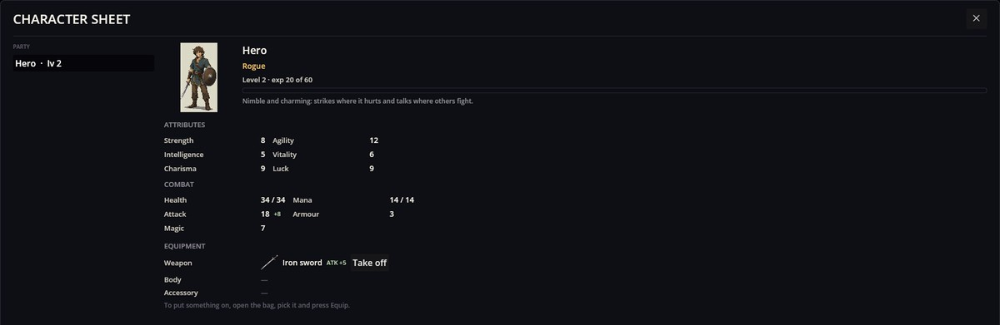
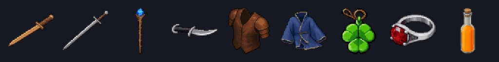

# Classic RPG Rules — bộ luật giả tưởng dùng ngay được

Classic RPG Rules là một gói luật: bên trong không có mã, chỉ có dữ liệu. Nó trao cho game bộ giả tưởng quen thuộc — sáu thuộc tính, máu và mana, ba lớp, ba ô trang bị, tám món đồ, một bình thuốc sức mạnh và bốn kỹ năng chiến đấu. RPG Plus được dựng trên gói này; tiểu thuyết tương tác cũng có thể lấy nó chỉ để làm phép kiểm sức hút.

Các luật vận hành thông qua những mod khác. Stats Engine tính số và hiển thị bảng chỉ số, Equipment biến đồ thành trang bị được, Items Base giữ đồ trong túi, Characters Engine lưu các thẻ kỹ năng, còn Battle Formulas khiến công thức kỹ năng chạy được trong trận. Gói này chỉ nói *có những gì*.

## Trong game

Một đạo tặc cấp 2 trong RPG Plus mang kiếm sắt:



Mọi con số đều đến từ gói luật này. Nhanh nhẹn của đạo tặc là `8 + level * 2` = 12. Tấn công theo công thức của gói `str + level` = 8 + 2 = 10, cộng đặc tính đạo tặc `floor(agi / 4)` = 3, cộng 5 điểm của kiếm sắt — **18**, trong đó **+8** là phần cộng. Sức mạnh 8 gồm `5 + level` của đạo tặc = 7 và một bình thuốc sức mạnh.

## Gói luật có gì

**Thuộc tính** (nhóm *Attributes*, mặc định 5): Sức mạnh `str`, Nhanh nhẹn `agi`, Trí tuệ `int`, Thể lực `vit`, Sức hút `cha`, May mắn `luk`.

**Chỉ số chiến đấu** (nhóm *Combat*) được suy ra từ thuộc tính:

```json
{ "Id": "hp",  "Formula": "12 + vit * 3 + level * 2", "Binds": "health" },
{ "Id": "mp",  "Formula": "int * 2 + level * 2", "Pool": true },
{ "Id": "atk", "Formula": "str + level", "Binds": "attack" },
{ "Id": "def", "Formula": "floor(vit / 2)", "Binds": "defence" },
{ "Id": "mag", "Formula": "int + level" }
```

Máu, tấn công và phòng thủ trở thành các con số chiến đấu; mana bị kỹ năng tiêu hao và được hồi lại.

**Lớp** — mỗi lớp cho thuộc tính lớn theo cấp, mang một đặc tính và học dần các kỹ năng:

- **Chiến binh** — khỏe và bền (`str 7 + level * 2`, `vit 6 + level * 2`), máu +10%; học Power strike ở cấp 1, Guard break ở cấp 3.
- **Pháp sư** — `int 8 + level * 2`, mana +25%; học Fireball ở cấp 1, Heal ở cấp 2.
- **Đạo tặc** — `agi 8 + level * 2`, sức hút và may mắn `7 + level`, tấn công thêm một phần tư nhanh nhẹn; học Power strike ở cấp 1, Guard break ở cấp 2.

**Ô trang bị**: Vũ khí (kiếm, trục, dao găm), Thân (giáp, áo choàng), Phụ kiện (bùa, nhẫn).

**Trang bị và một bình thuốc**:



- Kiếm gỗ: tấn công +2. Kiếm sắt (chiến binh, đạo tặc): tấn công +5. Gậy gỗ sồi (pháp sư): phép +4, mana +5. Dao găm: tấn công +3, nhanh nhẹn +2.
- Giáp da: phòng thủ +2, máu +6. Áo choàng: mana +6, trí tuệ +1.
- Bùa cỏ bốn lá: may mắn +3. Nhẫn bạc: sức hút +2.
- Thuốc sức mạnh: sức mạnh +1 vĩnh viễn.

**Kỹ năng** — các hành động chiến đấu mà con số do công thức quyết định (`a` là người hành động, `b` là mục tiêu):


```json
{ "Id": "classic/fireball", "Type": "ToEnemy",
  "Values": [ "RequiredPoint=1", "Cost=mp:4", "Pierce=1", "Formula=a.mag * 2 + rand(1, 6)" ] }
```

- Power strike: `a.atk * 1.5 + rand(0, a.str / 2)`.
- Fireball: tốn 4 mana, bỏ qua giáp, `a.mag * 2 + rand(1, 6)`.
- Heal: tốn 3 mana, tự chữa `a.mag * 2 + 4` máu.
- Guard break: bỏ qua giáp, `a.atk + b.defence * 2`, 35% cơ hội gây choáng một lượt.

## RPG Plus dùng nó thế nào

- Câu trả lời đầu tiên trong phần mở đầu trao cho anh hùng một trong ba lớp cùng vũ khí khởi đầu.
- Tiểu thương trong làng bán kiếm, dao găm, trục và giáp (RPG Plus thêm chúng vào cửa hàng bằng một bản vá).
- Sân tập đưa cho bạn một bình thuốc sức mạnh; nhà tiên tri đưa bùa cỏ bốn lá.
- Trong trận chiến, các kỹ năng vận hành qua Battle Formulas, cả ở hệ thống chiến đấu mặc định lẫn hệ thống thẻ bài.

## Dùng trong game của bạn

Thêm `classic_rpg_pack` vào bộ sưu tập của game; các mod mà nó phụ thuộc sẽ được nạp cùng. Sau đó trao lớp cho nhân vật bằng hành động `action stat.archetype who=<id> id=classic/warrior`, hoặc đặt `\"Archetype\": \"classic/mage\"` trong JSON của nhân vật. Muốn đổi một luật, hãy phát hành thực thể cùng id trong một mod phụ thuộc gói này, hoặc vá lại.

## Khi có sự cố

1. **Kỹ năng chẳng có tác dụng trong trận.** Game cần Battle Formulas để xử lý các giá trị `Formula=`.
2. **Bảng chỉ số của một nhân vật không có số.** Nhân vật đó chưa có lớp cũng như chỉ số riêng; hãy trao cho nó một nguyên mẫu.
